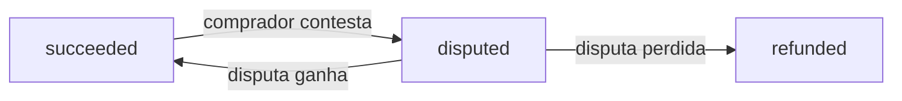

## Devolver um Pix

Você pode devolver todo ou parte de um Pix aprovado. O dinheiro volta **para quem pagou**, nunca para outra conta.

```bash
curl https://api.valorapayments.com.br/v1/payments/pay_Xk2v9QeR7tLmN3bA/refund \
  -H "Authorization: Bearer $VALORA_API_KEY" \
  -H "Content-Type: application/json" \
  -d '{ "amount": "20.00", "reason": "Item fora de estoque" }'
```

- Sem `amount`, a Valora devolve tudo o que ainda resta.
- Com `amount`, devolve só esse valor (em reais). Você pode fazer várias devoluções parciais até o total pago.
- O valor devolvido sai do seu saldo **disponível**. Sem saldo suficiente, a resposta é `409 insufficient_balance`.

A resposta (`201`) traz a devolução e o pagamento atualizado:

```json
{
  "id": "ref_Lp09Ok87Ij65Uh43",
  "object": "refund",
  "payment_id": "pay_Xk2v9QeR7tLmN3bA",
  "amount": 2000,
  "status": "succeeded",
  "reason": "Item fora de estoque",
  "payment": { "id": "pay_Xk2v9QeR7tLmN3bA", "status": "partially_refunded", "refunded_amount": 2000 }
}
```

Depois de cada devolução, você recebe o evento `payment.refunded`. O pagamento fica `partially_refunded` enquanto sobrar valor e `refunded` quando tudo foi devolvido.

<Note>
  Se o banco do pagador demorar a responder, a API pode devolver `202 provider_pending`. A devolução continua em andamento e o evento `payment.refunded` chega quando ela concluir.
</Note>

### Cartão e boleto

Devoluções de cartão e de boleto não são feitas pela API. Para devolver um desses pagamentos, fale com o [suporte da Valora](/ajuda/suporte).

## Contestações no cartão

Uma contestação (chargeback) acontece quando o comprador pede ao banco o cancelamento de uma compra no cartão.



| Momento | Status | Evento | Saldo |
| - | - | - | - |
| Contestação aberta | `disputed` | `payment.disputed` | o valor sai do seu saldo |
| Disputa ganha | `succeeded` | `payment.dispute_won` | o valor volta ao seu saldo |
| Disputa perdida | `refunded` | `payment.dispute_lost` | o estorno ao comprador se confirma |

O campo `dispute` do pagamento mostra o estado (`open`, `won`, `lost`) e as datas de abertura e encerramento.

<Tip>
  Ao receber `payment.disputed`, junte comprovantes de entrega e de contato com o cliente. Eles ajudam a ganhar a disputa.
</Tip>
