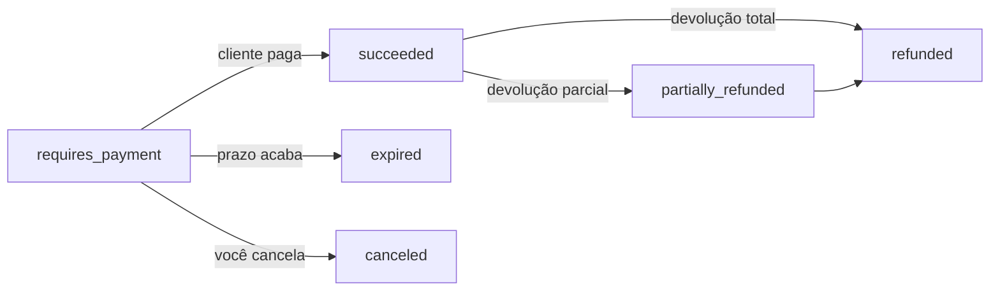

O Pix é a forma de pagamento mais rápida: o cliente paga pelo app do banco e a confirmação chega em segundos. Você pode cobrar Pix de duas formas:

- **No checkout** (link fixo ou `POST /v1/checkouts`): a Valora mostra o QR Code ao cliente.
- **Direto pela API** (`POST /v1/payments`): você recebe o QR Code e o copia e cola e mostra na sua própria tela.

## Criar uma cobrança Pix pela API

<Tabs>
  <Tab title="cURL">
    ```bash
    curl https://api.valorapayments.com.br/v1/payments \
      -H "Authorization: Bearer $VALORA_API_KEY" \
      -H "Content-Type: application/json" \
      -H "Idempotency-Key: pedido-1001" \
      -d '{
        "method": "pix",
        "amount": "149.90",
        "description": "Pedido 1001",
        "external_reference": "pedido-1001",
        "expires_in": 1800
      }'
    ```
  </Tab>
  <Tab title="Node.js">
    ```js
    const res = await fetch("https://api.valorapayments.com.br/v1/payments", {
      method: "POST",
      headers: {
        Authorization: `Bearer ${process.env.VALORA_API_KEY}`,
        "Content-Type": "application/json",
        "Idempotency-Key": "pedido-1001",
      },
      body: JSON.stringify({
        method: "pix",
        amount: "149.90",
        description: "Pedido 1001",
        external_reference: "pedido-1001",
        expires_in: 1800,
      }),
    });
    const payment = await res.json();
    // payment.pix.brcode  -> copia e cola
    // payment.pix.qr_image -> QR Code (PNG em data URL)
    ```
  </Tab>
  <Tab title="Python">
    ```python
    import os, requests

    res = requests.post(
        "https://api.valorapayments.com.br/v1/payments",
        headers={
            "Authorization": f"Bearer {os.environ['VALORA_API_KEY']}",
            "Idempotency-Key": "pedido-1001",
        },
        json={
            "method": "pix",
            "amount": "149.90",
            "description": "Pedido 1001",
            "external_reference": "pedido-1001",
            "expires_in": 1800,
        },
    )
    payment = res.json()
    ```
  </Tab>
</Tabs>

### Valor: em reais ou pelo produto

Envie **um** dos dois:

- `amount`: valor em reais, como texto ou número, com até 2 casas (`"149.90"`, `149.9`).
- `product_id` + `quantity`: a Valora calcula o valor pelo preço do produto. O cliente não consegue mudar o preço.

<Warning>
  Na entrada, o valor vai em **reais**. Nas respostas, todo valor vem em **centavos inteiros**: `"149.90"` volta como `14990`.
</Warning>

### Validade

`expires_in` define quanto tempo o Pix vale, em segundos: de 60 (1 min) a 86400 (24 h). O padrão é 3600 (1 h). Depois disso, o pagamento muda para `expired` e você recebe `payment.expired`.

### Exibir para o cliente

| Campo | Uso |
| - | - |
| `pix.qr_image` | QR Code em PNG, pronto para `` |
| `pix.brcode` | código copia e cola |
| `expires_at` | prazo para mostrar um cronômetro |

## Ciclo de vida



| Status | Significado | Evento |
| - | - | - |
| `requires_payment` | Pix criado, aguardando pagamento | — |
| `succeeded` | pago e confirmado | `payment.succeeded` |
| `expired` | o prazo acabou sem pagamento | `payment.expired` |
| `canceled` | cancelado por você antes do pagamento | `payment.canceled` |
| `partially_refunded` / `refunded` | parte ou todo o valor foi devolvido ao pagador | `payment.refunded` |

<Note>
  Um Pix pago com valor diferente do cobrado, ou pago depois de cancelado, não vira crédito automaticamente. Ele fica marcado para análise da Valora e não libera o pedido.
</Note>

## Quem pagou

Depois da confirmação, `pix.payer` traz o nome e o documento **mascarado** de quem pagou, e `pix.e2e_id` traz o identificador da transação no Banco Central. Use para conciliar e para atender o cliente.

## Cancelar um Pix

Enquanto o Pix está em `requires_payment`, você pode cancelar com `POST /v1/payments/{payment_id}/cancel`. O QR Code deixa de valer.

## Saldo

O valor de um Pix confirmado entra no saldo **disponível** na hora, já descontada a taxa.

## Próximos passos

<Columns cols={2}>
  <Card title="Devoluções" icon="rotate-left" href="/recursos/devolucoes-e-contestacoes">
    Devolva todo ou parte de um Pix ao pagador.
  </Card>
  <Card title="Idempotência" icon="repeat" href="/integrar/idempotencia">
    Evite cobrar duas vezes o mesmo pedido.
  </Card>
</Columns>
